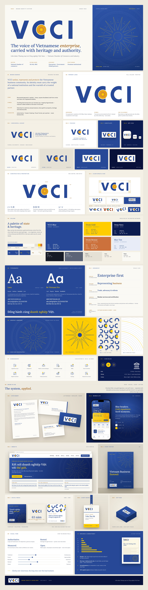

# Bộ nhận diện thương hiệu VCCI

Hệ thống nhận diện thương hiệu cho **Liên đoàn Thương mại và Công nghiệp Việt Nam** (VCCI · Vietnam Chamber of Commerce and Industry): logo, màu sắc, kiểu chữ, họa tiết trống đồng, bộ icon, template Word và PowerPoint, và tài liệu hướng dẫn 36 trang. Repo chứa cả sản phẩm hoàn chỉnh lẫn công cụ để dựng lại toàn bộ từ file logo gốc.



## Dùng ngay

Mọi thứ cần để làm ấn phẩm nằm trong [`brand-assets/`](brand-assets/README.md):

| Thư mục | Nội dung |
|---|---|
| [`01_Logo`](brand-assets/01_Logo) | Logo chính, lockup song ngữ ngang và đứng, bản trên ô nền sáng: SVG, PNG, PDF; file gốc CorelDRAW |
| [`02_Colour`](brand-assets/02_Colour) | Bảng màu, thang sắc độ, màu trạng thái và màu biểu đồ cho Office, Adobe (ASE), CSS, JSON |
| [`03_Fonts`](brand-assets/03_Fonts) | Lora và Be Vietnam Pro (SIL OFL 1.1) |
| [`04_Graphics`](brand-assets/04_Graphics) | Họa tiết vòng trống đồng, mặt trời 14 cánh, cung chữ C, trường chấm |
| [`05_Icons`](brand-assets/05_Icons) | 48 icon giao diện, 24 hero icon theo lĩnh vực của VCCI |
| [`06_Templates`](brand-assets/06_Templates/README.md) | Template Word (thư, báo cáo, thư mời) và PowerPoint 16:9 (18 layout) |
| [`07_Guidelines`](brand-assets/07_Guidelines) | **Hướng dẫn Nhận diện Thương hiệu VCCI** (PDF, tiếng Việt) |
| [`brand-tokens.json`](brand-assets/brand-tokens.json) | Toàn bộ thông số (màu, tỉ lệ logo, thang chữ, khoảng cách) dạng máy đọc được |

### Năm quy tắc cốt lõi

1. Logo chỉ có **một phiên bản màu**: chữ VCCI Blue (CMYK 100/80/0/0), trống đồng giữ màu gốc, đặt trên nền sáng.
2. Trên nền xanh, nền tối hoặc ảnh: đặt logo trên **ô nền sáng**. **Không** dùng logo chữ trắng (kiêng kị văn hóa), không dùng chữ vàng, không tách trống đồng ra dùng riêng.
3. Khoảng trống bảo vệ **x = bán kính trống đồng** (≈ 0,26 chiều cao chữ).
4. Hai họ chữ: **Lora** cho tiêu đề, **Be Vietnam Pro** cho nội dung.
5. **Một điểm nhấn vàng** trên mỗi bố cục.

Chi tiết trong [tài liệu hướng dẫn](brand-assets/07_Guidelines/VCCI_Huong-dan-Nhan-dien-Thuong-hieu_v1.1.pdf).

## Dùng với AI agent (Claude Code, Codex)

Repo có sẵn skill [`vcci-brand`](skills/vcci-brand/SKILL.md) để agent chuyển tài liệu thô sang bộ nhận diện VCCI:

- **File Word thô thành báo cáo VCCI:** bìa trước, mục lục, chương có nhãn và gạch vàng, kiểu bảng VCCI, chú thích hình và bảng, chú thích cuối trang, bìa sau.
- **File PowerPoint thô (hoặc dàn ý) thành bài trình bày VCCI:** dựng trên 18 layout của template, có thêm thẻ số liệu, biểu đồ thật (sửa được số liệu), thẻ nội dung, chuỗi bước, bảng, slide chuyển chương có hero icon.

Quy trình gồm bốn bước:

1. Script trích nội dung thô ra Markdown.
2. Agent đánh dấu cấu trúc. Agent không sửa câu chữ hay số liệu.
3. Script dựng file theo template.
4. `finalize.py` dùng Word hoặc PowerPoint trên Windows để xuất PDF và ảnh từng trang cho agent tự kiểm tra.

Ví dụ (số liệu giả lập): [báo cáo](skills/vcci-brand/examples/sample-report_VCCI.pdf), [bài trình bày](skills/vcci-brand/examples/sample-deck_VCCI.pdf).

**Claude Code:** cài như một plugin.

```
/plugin marketplace add <tài-khoản-GitHub>/vcci-brand-identity
/plugin install vcci-brand@vcci-brand-identity
```

Sau đó chỉ cần yêu cầu, ví dụ: *"Định dạng bao_cao_tho.docx thành báo cáo VCCI"* hoặc *"Chuyển slide_tho.pptx sang mẫu trình bày VCCI"*.

**Codex và các agent khác:** clone repo này. Khi làm việc trong thư mục repo, agent đọc [`AGENTS.md`](AGENTS.md). Để dùng skill ở thư mục khác, chép `skills/vcci-brand` vào thư mục skill của agent và đặt biến môi trường `VCCI_BRAND_ROOT` trỏ tới bản clone, để script tìm được template và icon.

Script cần Python 3.9 trở lên, `lxml`, `Pillow` và `python-pptx` (`pip install lxml pillow python-pptx`). Thư, công văn và thư mời vẫn dùng template thủ công.

## Cấu trúc repo

```
brand-assets/    Sản phẩm bàn giao: logo, màu, font, họa tiết, icon, template, hướng dẫn
board/           Bảng nhận diện một trang (HTML) và bản xuất PNG/PDF
skills/          Skill cho AI agent (vcci-brand); .claude-plugin/ khai báo plugin cho Claude Code
docs/            Nhật ký quyết định thiết kế; hồ sơ bàn giao bộ icon
source/          Đầu vào gốc: logo CorelDRAW và các bản logo cũ
tools/           Công cụ dựng lại toàn bộ sản phẩm (Python, Node.js)
build/           File trung gian khi dựng (không đưa lên git)
```

## Dựng lại từ nguồn

Yêu cầu: Windows; Python 3.12 trở lên; Node.js 18 trở lên; Microsoft Edge; Poppler (`pdftoppm`); Microsoft Word và PowerPoint cho bước template.

Trên Windows, nên clone với tùy chọn đường dẫn dài. Một số tên file icon dài, nên clone vào thư mục sâu có thể vượt giới hạn 260 ký tự và báo lỗi "Filename too long":

```bash
git -c core.longpaths=true clone <địa-chỉ-repo>
```

```bash
pip install -r requirements.txt
npm install
python tools/build.py all
```

Có thể chạy từng bước: `logo`, `assets`, `board`, `word`, `ppt`, `guide`. Xem [`tools/README.md`](tools/README.md).

## Ghi công

- Phát triển và thiết kế: **Truong Duc Trong**.
- Thiết kế hệ thống, logo vector, template và tài liệu hướng dẫn: thực hiện cùng Claude (Anthropic).
- Bộ icon v1: thực hiện cùng một agent ChatGPT theo [hồ sơ bàn giao](docs/handoff-icons/); icon giao diện dựa trên [Lucide](https://lucide.dev) (ISC).
- Font: [Lora](https://github.com/cyrealtype/Lora-Cyrillic) và [Be Vietnam Pro](https://github.com/bettergui/BeVietnamPro), SIL Open Font License 1.1.

## Giấy phép

Logo và tên VCCI là tài sản của Liên đoàn Thương mại và Công nghiệp Việt Nam. Mã nguồn trong `tools/` và các script trong `skills/` dùng giấy phép MIT. Chi tiết từng phần trong [LICENSE.md](LICENSE.md).
